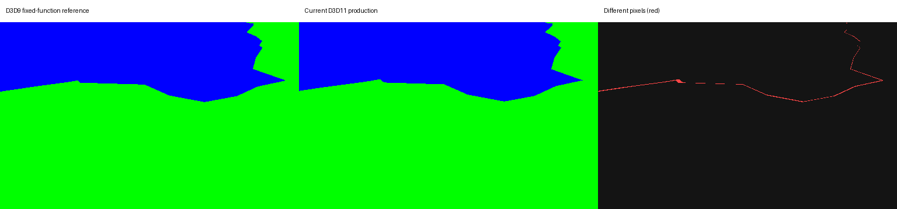

# Visual parity audit: D3D11 versus the original D3D9 client

Audited 3 November 2026 against commit `030082fa8a6b70dc0cfb020abffeac2086762291`.
The graphics sources reviewed here match that commit. A concurrent local edit to
the window title was left untouched; runtime observations used the existing
executable, not a rebuild of that edit.

The audit found three source-level rendering mismatches, a documented replacement
shader with unverified fidelity, and an intentional shoreline rasterization change.
Complete visual parity remains unverified. Priorities below concern visual fidelity;
none establishes a crash or a general failure to render.

## Findings

### 1. P2: Reflective actors can retain highlights when backlit

The original static and skinned actor shaders compute the light/normal dot product
before `LIT`: [original static shader](../src/client/graphics/render_shader_text.h#L93)
and [skinned shader](../src/client/graphics/render_shader_text.h#L41).
`LIT` makes the specular coefficient zero when that dot product is negative.
[Microsoft documents this rule](https://learn.microsoft.com/en-us/windows/win32/direct3dhlsl/dx-graphics-hlsl-lit).

The current [reflection vertex shader](../src/client/graphics/native_render_shaders.h#L166)
computes `specularColor.r * pow(max(N dot H, 0), power)` without that gate.
The [pixel shader](../src/client/graphics/native_render_shaders.h#L224) then adds
the environment texture multiplied by this coefficient and the base texture's alpha.
Both static and skinned reflective paths use this calculation.

A numerical witness with identity world transform is:

```text
normal N       = (0, 0, 1)
toward-light L = (sqrt(3)/2, 0, -0.5)
toward-eye E   = (-0.5, 0, sqrt(3)/2)
H              = normalize(L + E)
power          = 2; specular red = 1

N dot L = -0.5; N dot H = 1/sqrt(2)
original specular coefficient = 0
current specular coefficient  = 0.5
```

**Visible implication:** reflective equipment can show extra environment highlights
on backlit or grazing surfaces. A nonblack environment, positive base alpha and a
visible reflective draw are required. The formula mismatch is confirmed; its
appearance in a matched gameplay frame has not been measured.

### 2. P2: Glow mode and quality selection no longer preserve the original pipelines

The current [fixed-function glow entry](../src/client/graphics/native_postfx_ports.cpp#L157)
delegates to the Gaussian blur. The [glow controller](../src/client/graphics/native_postfx_ports.cpp#L160)
always captures, applies the eight-tap filter, and performs Gaussian iterations.
The [composite](../src/client/graphics/native_postfx_ports.cpp#L175) uses an additive
copy with one [strength value](../src/client/graphics/native_postfx_ports.cpp#L100).

The original procedure `0x0054f860` selects between distinct pipelines using the
owner's mode byte. Its fallback calls `0x0054f250`, a weighted multi-quad operation;
original initialization at `0x0054e7c0` explicitly selects that fallback. The
original level setter `0x0054e490` changes several sampling/composite weights and
effect-dependent behavior. The current implementation does not retain those choices.

**Visible implication:** glow footprint, brightness and the response to quality
levels can differ. This affects a configured feature: the supplied settings use
`GLOW_LEVEL=2`. The control-flow difference is confirmed; the amount of full-frame
visual difference has not been measured.

### 3. P2, conditional: Gamma differs in the original locale-1 fullscreen mode

The current [gamma entry](../src/client/graphics/render_gamma.cpp#L4) stores a scalar,
and [the final shader](../src/client/graphics/native_render_shaders.h#L301) applies
`pow(color, 1/gamma)` to the client frame.

Original procedure `0x005414f0` has two paths. One builds a power-curve OS gamma
ramp; the other scales the device-ramp entries linearly. Original initialization
at `0x00541fe0` selects the linear path for locale 1 in fullscreen, and the OS path
when the locale differs or fullscreen is disabled. The reconstruction always uses
its power shader.

For an input channel of 128 and a **function gamma argument of 2**, the original
linear ramp gives approximately `65280/65535 = 0.996`, while the native shader gives
`sqrt(128/255) = 0.708`. This is a formula example, not a display measurement.
The INI setting `GAMMA=2` maps to function gamma 1.0; it is not that example.

The supplied locale-6/windowed setup does not select the original linear path.
Native correction is also intentionally confined to the client frame, whereas
the original uses display/device ramps. Display-ramp quantization and capture
behavior require separate validation.

### 4. Unverified fidelity: BumpReflect is an authored replacement

The [BumpReflect shader](../src/client/graphics/native_render_shaders.h#L280) uses
new environment-mapping code and a fixed `0.25 + 0.75 * lighting` expression.
The original external `BumpWater_R.fx` source was unavailable during recovery.

Reflection brightness, highlight direction and the appearance of this optional
material have no established original-client pixel match. This is a known
reconstruction gap; the audit did not demonstrate a new frame-level regression.
It should not be generalized to every water or reflection pass.

### 5. Measured intentional difference: Basic-water shoreline coverage changes

[Basic water](../src/client/graphics/native_geometry_ports.cpp#L179) subdivides the
original two-triangle plane into a finer cached mesh while retaining its surface
height, UVs and color. A fresh execution of the retained D3D9/D3D11 GPU oracle
reproduced its recorded results. Every recorded input and the oracle executable
were hash-checked; all 17 production source inputs match this checkout.

The fixture uses captured Rivalis terrain/camera data, solid green terrain and
blue water, D24S8 depth with LESS_EQUAL, zero bias, and eight small camera-yaw steps
at 512 by 320 pixels.

| Render path | Pixels changing more than once across the eight steps |
| --- | ---: |
| D3D9 reference | 1,164 |
| D3D11 coarse-plane control | 780 |
| Current D3D11 production subdivision | 50 |

The current D3D11 and D3D9 images differ by **84 to 617 of 163,840 pixels per
frame**, or **0.051% to 0.377%**, around the shoreline boundary. These percentages
describe this controlled depth fixture only. They are not a whole-game similarity
score or a measurement of water color, textures or reflections.



The figure shows the step with 617 differing pixels. Reduced temporal instability
and changed boundary coverage are both measured. [Raw measurements and input
hashes](visual-audit/shore-depth.json) accompany this report.

## Coverage and limits

Existing semantic suites cover UI, terrain, lighting, skinning, clipping, fog,
water, glow, gamma, textures and shadows. Their recorded production sources match
the corresponding current files, but the suites primarily check expected native
behavior. They do not establish original D3D9 image parity. For example, the native
render-pass suite records 676 checks and 142 pixel checks with no D3D9 runtime
loaded; its gamma test expects the authored power curve.

Font rendering uses an authored GDI/Uniscribe glyph atlas. Existing tests check
measurement consistency, glyph presence, color, labels and calling conventions,
without paired original D3DXFont bitmaps. Font rasterization and layout parity
remain unverified; no specific current layout regression was established.

The source review did not establish an anisotropy or MSAA regression. Original
startup sets linear MAG/MIN/MIP sampling and initializes multisampling to none,
consistent with the native baseline. `USER/USE_FILTER` is a chat setting.

A bounded full-client capture attempt used isolated runtime directories and a
temporary localhost fixture. The original reference was verified to differ from
the original executable only by the 47 documented localhost endpoint-string edits.
Both clients received identical initial configuration files. The final attempt
configured windowed 1024 by 768, INI gamma 1, glow 2, and disabled water/shadows.
The original displayed an initialization error without a game window. The native
client connected, but hidden-window `PrintWindow` capture failed and returned
black buffers. **No usable paired full-client capture resulted.** Those buffers
are capture failures, not evidence of black rendering. All owned clients and the
temporary server were cleaned up.

## Recommended verification order

1. Add a backlit reflective-actor case using the original `LIT` rule and the
   current production shader, then check representative equipment in a matched scene.
2. Compare glow levels 0 through 4 against the original mode-dependent pipelines
   with fixed camera, frame time and render-target dimensions.
3. Check locale-1 fullscreen gamma separately from the supplied windowed setup.
4. Capture synchronized login, character selection and world scenes for fonts,
   terrain, actors, shadows and water, recording settings and effect state.
5. Treat BumpReflect as an authored material until an original effect reference
   can support a stronger comparison.

## Reference provenance

- Original executable SHA-256:
  `796af141fd13451bab67ae0bae02d2177b1fe60af51775f296bec7b0eff752da`.
- Localhost-only D3D9 reference SHA-256:
  `7211e3b3492c2c63b7bb4199ce24b13c0ae176d7015ca90ce6d0ca3e79303f12`.
- Original branch evidence comes from the previous `shaiya` reference workspace:
  `recovered/ghidra/0x0054e7c0.c`, `0x0054e490.c`, `0x0054f250.c`,
  `0x0054f860.c`, `0x0054ea70.c`, `0x005414f0.c`, `0x00541fe0.c`, and
  `evidence/cpp-render-gamma-disassembly.txt`. These are review artifacts, not
  original developer source or build dependencies.
- The retained comparison harness is `tools/fixtures/native_shore_depth.cpp`,
  driven by `tools/verify_native_shore_depth.py` in that reference workspace.
  Detailed fresh-run artifacts and the full-client observation remain locally
  under `.zig-cache/visual-audit/`.

No production rendering code was changed during this audit.
